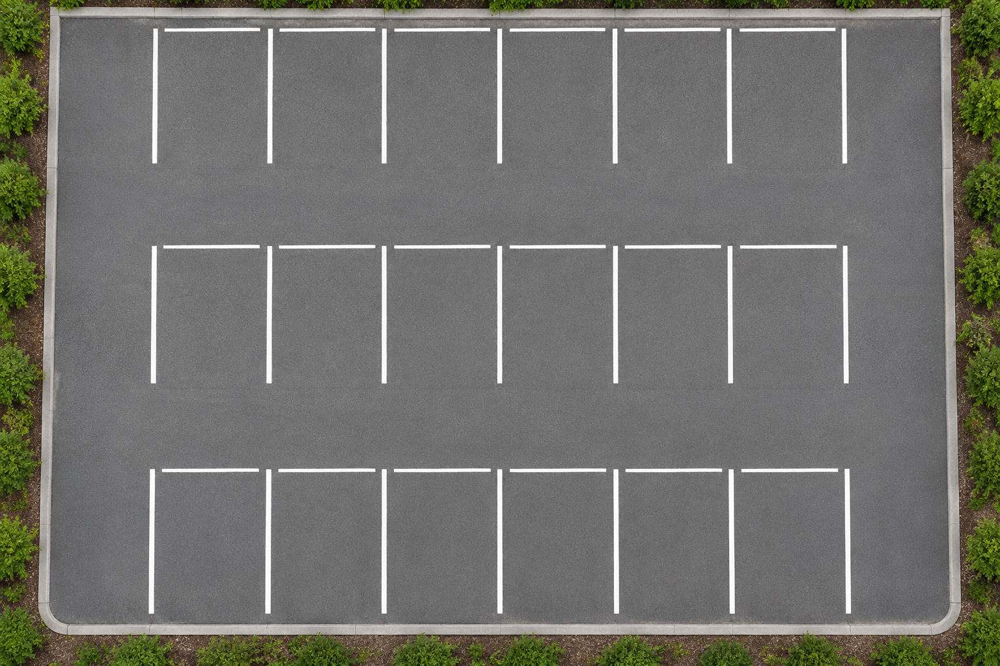
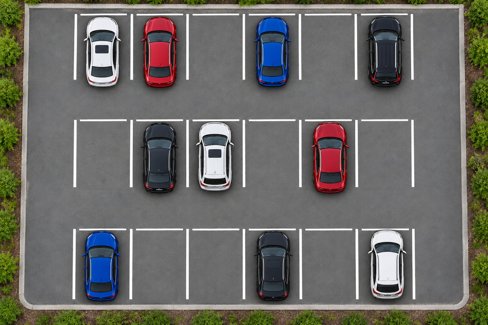

# Smart Parking

Given an image of a parking lot, which marked spaces look occupied, and which lane still has room? Smart Parking compares that image with an empty reference taken from the same viewpoint. You mark the spaces in a MATLAB interface, and it estimates occupancy from the changed pixels and recommends a lane with available spaces.

**MATLAB R2021a+ · No additional toolboxes**

| Empty reference | Current sample |
| :---: | :---: |
|  |  |

These are **synthetic parking-lot sample images**, not real camera photographs or detection results. The pair shows 18 spaces; the historical **Bundled demo** preset assumes a different 36-space layout.

## Try it

Open the repository in MATLAB and run:

```matlab
smartParking
```

Choose **Choose images**, select `car.jpeg` as the current image and `bg.jpeg` as the empty reference, then use **Mark spaces** to define each space and assign a lane. Save the layout to reuse it. Start with the default thresholds, inspect the overlay, and export per-space results to CSV.

## How it works

`analyzeParking.m` converts both images to grayscale and compares their pixels. After filtering isolated changes, it measures how much of each marked space looks different. With the defaults, a pixel difference above 0.15 counts as changed; a space is marked occupied when at least 18% of its pixels have changed. The app recommends the highest-numbered lane that still has a free space.

This is image comparison, not a trained vehicle detector. The images must line up. Shadows, lighting changes, people, and camera movement can be mistaken for cars. The project has no real-camera accuracy benchmark.

## Tests

```matlab
results = runtests('testParking.m');
assert(~isempty(results), 'No tests discovered.');
assert(all([results.Passed]), 'Some tests failed.');
```

The synthetic regression tests cover occupancy, lane selection, input validation, grayscale/RGB images, resizing, and noise. They do not replace evaluation on real camera images.

[Detailed usage and implementation](GUIDE.md)
