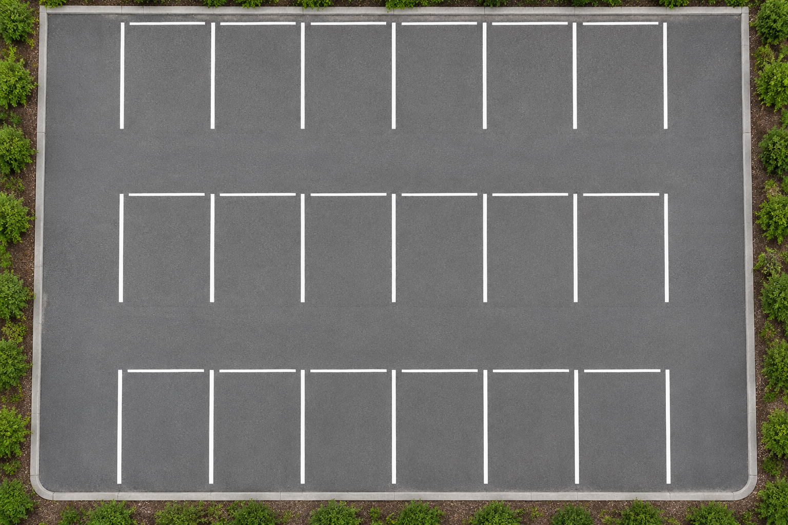
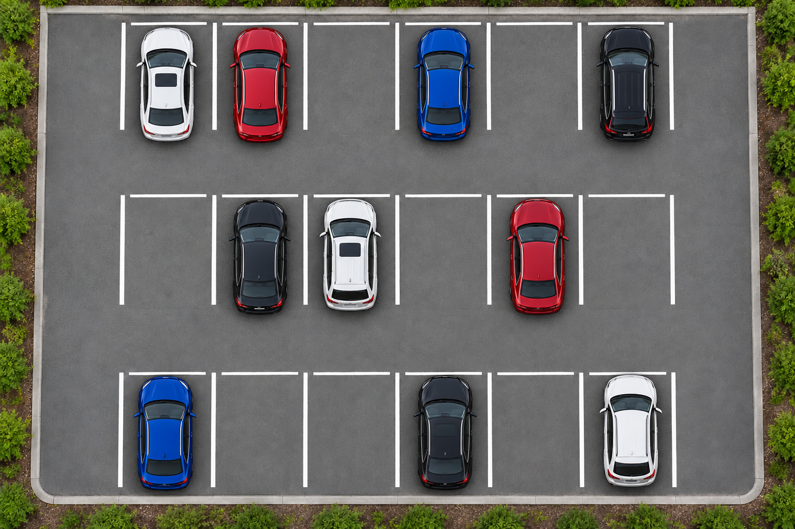

# Smart Parking

Given an image of a parking lot, which marked spaces look occupied, and which lane still has room? Smart Parking compares that image with an empty reference taken from the same viewpoint. You mark the spaces in a MATLAB interface or load a saved layout, and it estimates occupancy from the changed pixels and recommends a lane with available spaces.

**MATLAB R2021a or later (tested on R2026b) · No additional toolboxes**

| Empty reference | Current sample |
| :---: | :---: |
|  |  |

These are **synthetic parking-lot sample images**, not real camera photographs or detection results. The pair shows 18 spaces. **Bundled demo** applies a historical 36-space preset that does not line up with them, so its counts and lane recommendation do not describe this picture.

## Try it

Make the repository MATLAB's current folder and run:

```matlab
smartParking
```

Choose **Choose images**, select `car.jpeg` as the current image and `bg.jpeg` as the empty reference, then use **Mark spaces** to define each space and assign a lane. You can save the layout and reload it later for the same camera view. Start with the default thresholds, which you can change on each run. If the two images differ in size, the app asks before resizing the reference.

The results window shows the occupied/free overlay beside the changed-pixel mask. Per-lane availability is printed in the Command Window. The optional CSV lists each space's lane, changed fraction, and occupied flag.

## How it works

`analyzeParking.m` converts both images to grayscale and compares their pixels. A 3 × 3 majority filter removes isolated changes, then it measures how much of each marked space looks different. With the defaults, a grayscale difference above 0.15 (on a 0–1 scale) counts as changed; a space is marked occupied when at least 18% of its pixels have changed. The app recommends the highest-numbered lane that still has a free space.

This is image comparison, not a trained vehicle detector. The images must line up. Shadows, lighting changes, people, and camera movement can be mistaken for cars, and a car close to the pavement's gray level can be missed. The project has no real-camera accuracy benchmark.

## Tests

```matlab
results = runtests('testParking.m');
assert(~isempty(results), 'No tests discovered.');
assert(all([results.Passed]), 'Some tests failed.');
```

The synthetic regression tests cover occupancy, lane selection, image and layout validation, grayscale/RGB images, resizing, and noise in `analyzeParking.m`. They do not cover the interface or replace evaluation on real camera images.

[Detailed usage and implementation](GUIDE.md)
