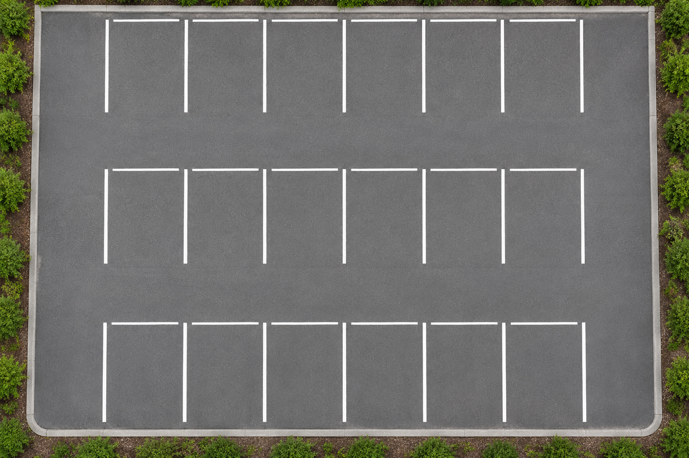
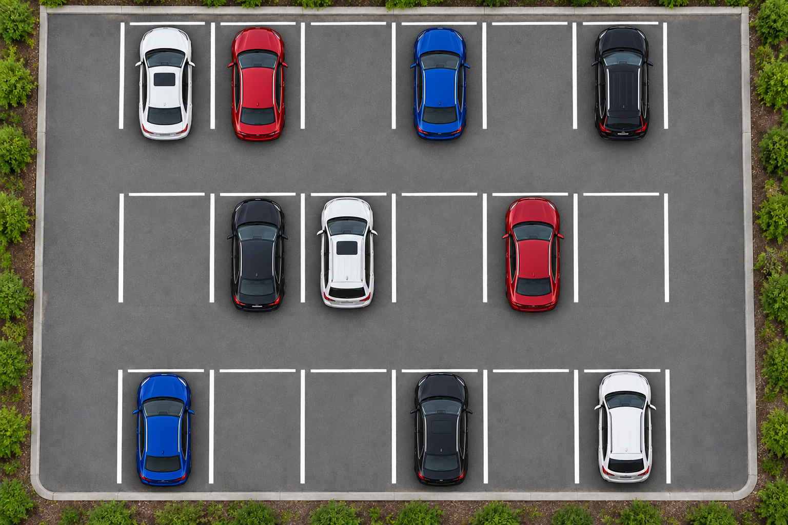

# Smart Parking

A MATLAB prototype that compares a parking image with an empty reference, estimates which marked spaces are occupied, and recommends an available lane.

**MATLAB R2021a+ · No additional toolboxes**

| Empty reference | Current sample |
| :---: | :---: |
|  |  |

These are **synthetic parking-lot sample images**, not real camera photographs or detection results. The pair shows 18 spaces; the historical **Bundled demo** preset assumes a different 36-space layout.

## Try it

Open the repository in MATLAB and run:

```matlab
smartParking
```

Choose **Choose images**, select `car.jpeg` as the current image and `bg.jpeg` as the empty reference, then use **Mark spaces** to define each space and assign a lane. Save the layout to reuse it. Start with the default thresholds, inspect the overlay, and export per-space results to CSV.

## How it works

`analyzeParking.m` converts the images to grayscale, takes their absolute difference, filters isolated changed pixels, and measures the changed fraction inside each region. The default pixel threshold is 0.15 and the occupied-fraction threshold is 0.18. The highest-numbered lane with available spaces is recommended.

This approach makes each decision inspectable, but depends on aligned images from a fixed viewpoint. Lighting, shadows, people, debris, and camera movement can all affect the result. It is not a trained vehicle detector, and no real-world accuracy benchmark has been established.

## Tests

```matlab
results = runtests('testParking.m');
assert(~isempty(results), 'No tests discovered.');
assert(all([results.Passed]), 'Some tests failed.');
```

The synthetic regression tests cover occupancy, lane selection, input validation, grayscale/RGB images, resizing, and noise. They do not replace evaluation on real camera images.

[Detailed usage and implementation](GUIDE.md)
